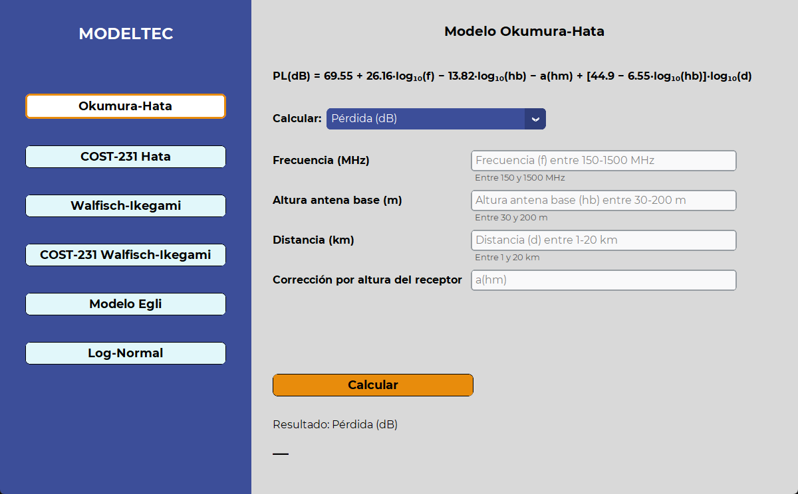

# Modelos de Propagación de Ondas


---

## 📡 Descripción

**MODELTEC** es una aplicación de escritorio en Python que calcula la **pérdida de trayecto** (*path loss*) de una señal de radio con seis modelos de propagación usados en telecomunicaciones. Pensada para estudiantes, investigadores y profesionales que trabajan en diseño y análisis de redes inalámbricas.

Además de calcular la pérdida (PL), cada modelo permite **despejar cualquier otra variable** (frecuencia, distancia, altura de antena…) a partir de la pérdida conocida.



---

## 📶 Modelos incluidos

| Modelo | Fórmula | Rango de validez en la app |
|---|---|---|
| **Okumura-Hata** | `69.55 + 26.16·log f − 13.82·log hb − a(hm) + (44.9 − 6.55·log hb)·log d` | f 150–1500 MHz · hb 30–200 m · d 1–20 km |
| **COST-231 Hata** | `46.3 + 33.9·log f − 13.82·log hb − a(hm) + (44.9 − 6.55·log hb)·log d + C` | f 1500–2000 MHz · hb 30–200 m · d 1–20 km · C 0–3 dB |
| **Walfisch-Ikegami** | `PL = L₀ + Lᵣₜₛ + Lₘₛd` | Suma de los tres términos (los ingresa el usuario) |
| **COST-231 Walfisch-Ikegami** (línea de vista) | `42.6 + 26·log d + 20·log f` | f 800–2000 MHz · d 0.02–5 km |
| **Egli** | `K + 20·log f + 40·log d − 20·log ht − a·log hr` | f 30–3000 MHz · ht 3–200 m · hr 1–50 m · d 0.1–20 km |
| **Log-Normal** | `PL(d₀) + 10·n·log(d/d₀) + Xσ` | d₀ 0.01–1 km · d 0.01–20 km · n 1–6 · Xσ ±20 dB |

Notas:

- Todos los logaritmos son de base 10. Frecuencia en MHz, distancias en km, alturas en m, pérdidas en dB.
- **Egli:** hr ≤ 10 m → K = 76.3 y a = 10; hr > 10 m → K = 85.9 y a = 20. (La constante 117 corresponde a la formulación original en millas y pies.)
- **Okumura-Hata y COST-231 Hata:** `a(hm)` (corrección por altura del receptor) se ingresa como dato.
- **COST-231 Hata:** C = 0 dB para ciudades medianas y suburbios, 3 dB para centros metropolitanos.
- **Log-Normal:** `Xσ` es un valor que ingresa el usuario, no se genera aleatoriamente.

---

## 🚀 Funcionalidades

- Seis modelos de propagación con su fórmula a la vista.
- Selector **"Calcular:"** para elegir qué variable despejar (por defecto, la pérdida).
- Resultado grande y con unidad (`126.35 dB`). **Enter** también calcula.
- Acepta la coma decimal (`1,5`).
- Validación dentro del formulario: el campo con problema se marca en rojo con el motivo y el rango válido; bajo cada campo se muestra su rango como ayuda.
- Aviso claro cuando un cálculo no es posible (por ejemplo, una división entre cero).
- Tipografía Montserrat incluida en el proyecto (no hace falta instalarla).

---

## 🛠 Instalación y uso

Requisitos: **Python 3.10+** con `tkinter` (incluido en la instalación estándar de Python para Windows y macOS).

```bash
git clone https://github.com/Yasmani-Vinamagua/modelos-propagacion-ondas.git
cd modelos-propagacion-ondas

pip install -r requirements.txt

python "modulos python/main.py"
```

> `requirements.txt` fija `customtkinter 5.2.0` y `numpy 1.24.3`, que requieren una versión de Python compatible (3.10 a 3.11 para esa versión de numpy). La aplicación y sus pruebas también se ejecutaron con Python 3.14, customtkinter 6 y numpy 2.

---

## 🧪 Pruebas

```bash
python -m pytest
```

Las pruebas no abren ventanas. Comprueban cada modelo (valores de referencia calculados aparte), que despejar cada variable devuelva el valor original y el comportamiento de la validación.

---

## 🗂 Estructura

```
modulos python/
├── main.py            Ventana principal y navegación entre modelos
├── ventana.py         Distribución de la ventana
├── estilos.py         Colores, fuentes y estilos de los widgets
├── modelo_base.py     Clase base: menú, formulario, validación y errores
├── mod_*.py           Un archivo por modelo (variables y fórmula)
└── fuentes/           Montserrat (licencia SIL OFL 1.1)
tests/                 Pruebas con pytest
```

### Agregar un modelo

1. Crea `mod_nuevo.py` con una clase que herede de `ModeloBase`.
2. Define `variables = {nombre: (mínimo, máximo, ayuda)}`. Con mínimo y máximo en 0, la variable no se valida (por ejemplo, la pérdida).
3. Implementa `calcular(self, v)`: devuelve el valor de la variable que está en `self.seleccion_modelo`, usando las demás de `v`.
4. Regístralo en `main.py` (ecuación y clase).

---

## 📄 Licencia

MIT © 2025 Yasmani Vinamagua (ver [`LICENSE`](./LICENSE)). La tipografía Montserrat se distribuye bajo la licencia SIL Open Font License 1.1 (`modulos python/fuentes/OFL.txt`).
